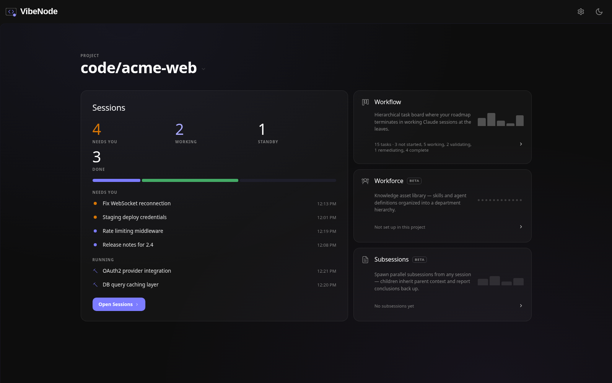
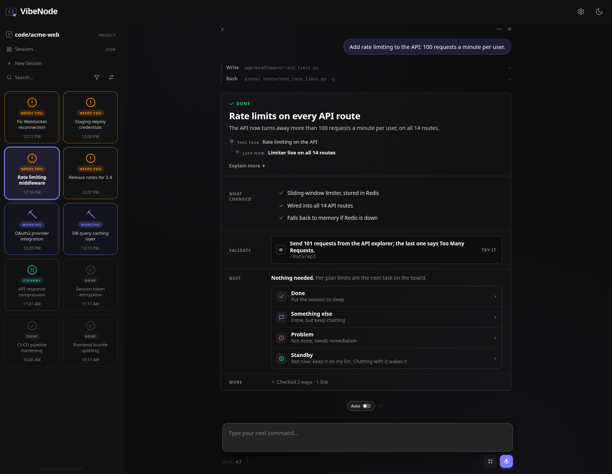
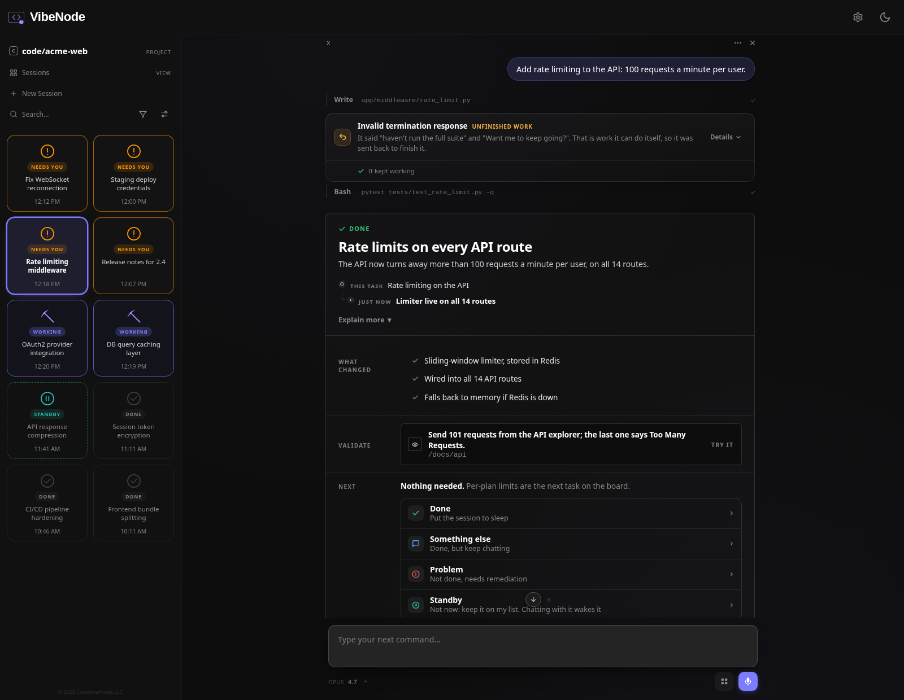
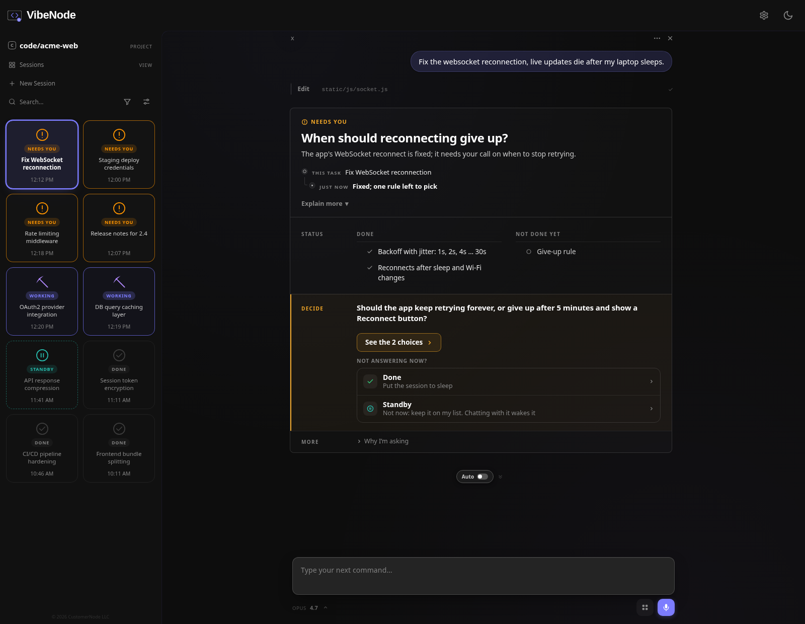
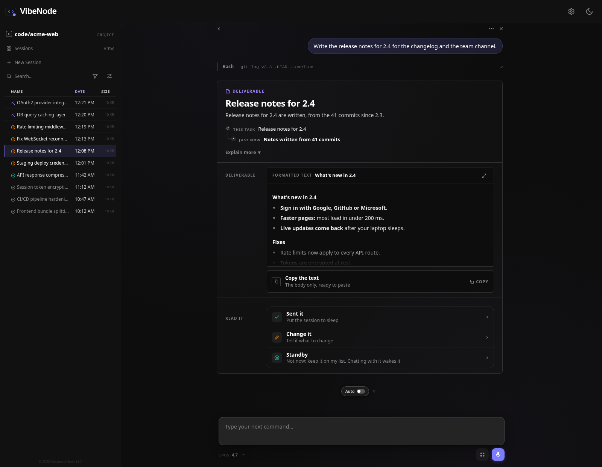
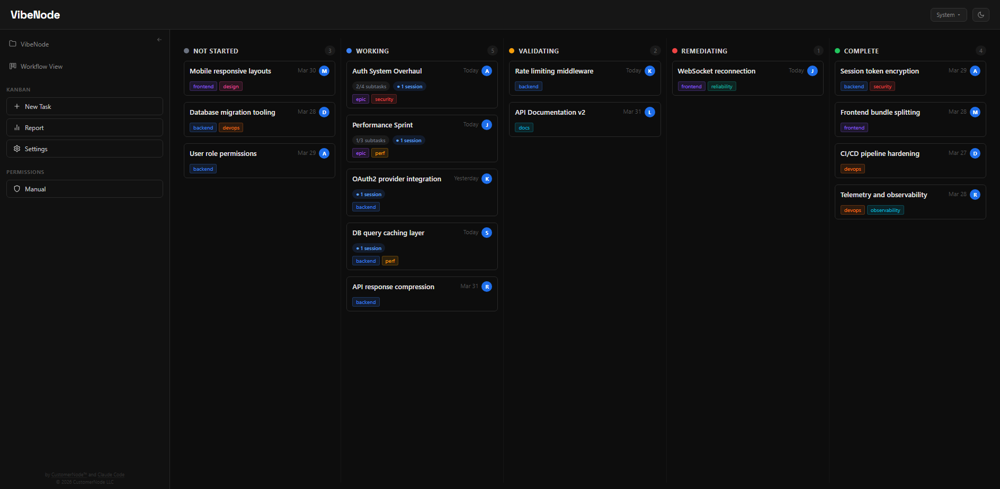
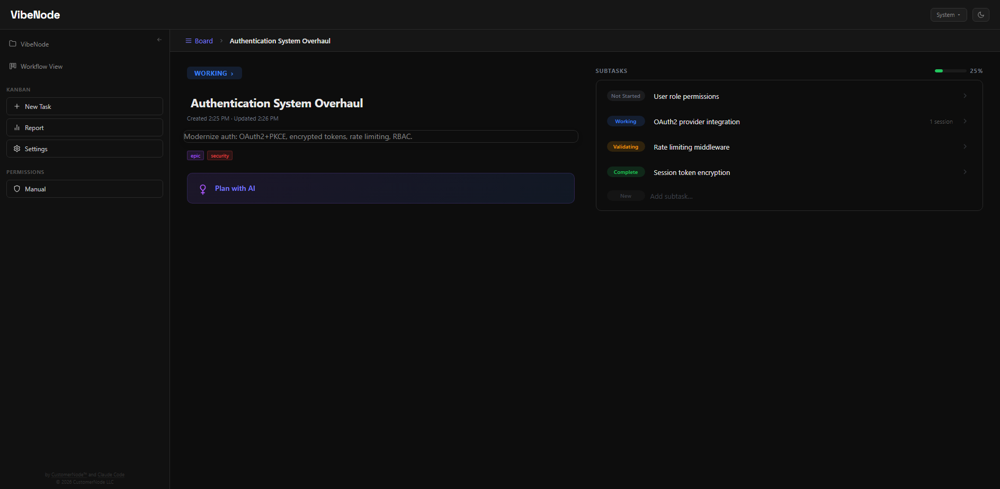

# VibeNode

**Agents made writing code cheap. Checking it is the new bottleneck. VibeNode is built for both halves.**

VibeNode is a development platform for agentic programming. A persistent Session Engine and a web control plane run a fleet of parallel coding agents: sessions that are aware of each other and avoid conflicts automatically, a hierarchical task board where your roadmap ends in working agent sessions, and one library for skills and agents. On top of that, **Smart termination** makes every session end its turn the same way: a short card that says what happened, how it was checked and exactly what it needs from you. A session that can't say that clearly is sent back until it can. Private mobile access and local voice input come with it. The orchestration layer is backend-agnostic by design; [Claude Code](https://claude.ai/download) is the currently supported backend (see [Supported backends](#supported-backends)). Built by [CustomerNode](https://customernode.com).



## Why we built this: generation leverage and validation leverage

Every coding-agent tool so far sells **generation leverage**: more code, more sessions, more output per hour. That part works. Run eight agents and you get eight streams of finished work.

What doesn't scale is the person on the other end. Every one of those streams ends in a reply someone has to read, judge and act on, and those replies aren't built for it:

- **They have no fixed shape.** Every reply has a different length and layout, so nothing can be skimmed. The one thing you need to do is somewhere in paragraph four.
- **They're written from the implementer's seat.** "Idle". "Want me to wire it in?" "Go with option C?" File names, function names, labels from an hour ago. The agent talks as if you'd been coding next to it all along, not switching in from five other sessions.
- **They hand unfinished work back.** "Mostly working, I haven't run the full suite yet" ends the turn, and the job lands on you.

So the more you generate, the more of your day goes to sifting. **Validation leverage** is the other half: multiplying how much one person can check, decide and accept in a minute. VibeNode does both.

It solves four problems that anyone running coding agents at scale runs into:

1. **Validation is the bottleneck.** Generation scales with compute. Your attention doesn't. VibeNode's **Smart termination** turns every session's last message into the same short, checkable card, written from your side, and sends back any session that ends in a wall of text, an unexplained "option C" or work it could have finished itself. The sidebar stops describing the agent ("Idle") and starts describing you: **Needs you**, **Working**, **Standby**, **Done**.

2. **Session sprawl.** Running 8+ coding-agent sessions across terminal windows gets unwieldy fast, permission prompts especially. Even a three-monitor setup runs out of space. VibeNode runs a *fleet* of agents graphically, not as a wall of terminals.

3. **Velocity without direction.** Coding agents are powerful, but raw throughput doesn't move a roadmap. Sessions drift, work gets duplicated, and nothing connects what an agent is doing with what you need delivered. VibeNode couples every session to a task plan so every agent is working toward a specific deliverable.

4. **Scattered, invisible knowledge assets.** Agentic coding tools have landed on two nearly identical concepts, skills and agents, that are really the same thing: a markdown file with instructions, differing only in how it's invoked. The files scatter across hidden config directories with no way to browse them. VibeNode gives you a visual library that treats them as one thing, organizes them into departments, and lets you build, browse, import and invoke them without caring whether they run inline or as a subprocess.

The result is a development platform where the human owns planning, oversight and validation while coding agents handle execution, scoped to tasks instead of left to wander. And VibeNode now does the heavy lifting on the human side as well: what used to be reading becomes glancing, and what used to be judging becomes one tap. Because the execution layer is pluggable, none of this depends on a single agent staying the best one.

## What it does

VibeNode is built around three pillars, **Sessions**, **Workflow** and **Workforce**, plus **Subsessions** for peeling side work off a running session. **Smart termination** runs through all of them: it decides how every session ends its turn and how that ending reaches you. The homepage is the command center for all of it.

The vocabulary, used the same way in the app, the settings and this document: a **session** is one Claude Code conversation; a session's status says what it needs from **you** (**Needs you**, **Working**, **Standby** or **Done**); the **handoff card** is how a session ends its turn; the **Workflow** is the task board; the **Workforce** is the library of agents and skills, organized into **departments**; **Subsessions** is the view for sessions spawned from other sessions, where a **composition** is a structured group of **sections**, each section being one child session; the **Session Engine** is the background process that owns every running session.

### Smart termination: every session ends in something you can act on in seconds

Turn it on under **System → Preferences → Smart termination** (it is off by default).

Every turn of every session ends in a **handoff card** with the same shape, whatever the session did:

- **A short title and one line on what happened**, in your words, not the code's: "Rate limits on every API route", not "Refactored `RateLimitMiddleware`".
- **This task / Just now.** Two lines that tell you where you are, so you can switch in from another session without scrolling back.
- **What changed and how it was checked.** The list of what was done, and the checks that ran, with their results.
- **Validate: Try it.** A row that opens the page, preview or demo where you can see it working yourself, right now.
- **Buttons that fit the ending.** Finished work gets **Done · Something else · Problem · Standby**. An answer gets **Got it**. A draft email or post gets **Sent it · Change it**. A decision shows each choice spelled out, and picking one sends it.
- **Explain more.** The card is short by force; the longer, plain-language version sits one tap away for when you've lost the thread.



**The gate.** The Session Engine checks every ending before the turn is allowed to finish. A session is **sent back**, with the reason, when it:

- ends with work it could do itself ("haven't run the full suite yet", "want me to keep going?");
- writes a wall of text (a card has a hard word limit, and lists stop at four items);
- refers to labels you can't know ("option C", "point 5") without saying what they are;
- claims something it didn't do ("tests pass" with no test run in the session);
- asks you to choose between designs without showing them;
- says "nothing needed from you" while quietly waiting on your yes.

You see the send-back as a small card in the thread, not as a message from you, and the session fixes its ending by itself:



**Statuses read from your side.** The sidebar, the homepage and the filters show what each session needs from *you*:

| Status | Meaning |
|---|---|
| **Needs you** | A decision, an approval, something only you can unblock, or finished work waiting for your verdict |
| **Working** | It's busy, or waiting on its own tests or a scheduled wake-up |
| **Standby** | You've seen it and set it aside for later; any new message brings it back |
| **Done** | You accepted it, and it's asleep |

There is no "Idle". A session that stopped is waiting for your verdict until you give one. Double-click a session to step it from Needs you to Standby to Done.

**Decisions you can see.** When a session needs you to pick something, the choices are spelled out on the card, each with its own button. If the choice is about how something looks, the session has to build each option as a real page. The Decide view shows each one full window, on Web or Phone, and you flip between them before you choose.



**Pick up where you left off.** The newest card shows the tasks you worked on before this one in the same session, each marked done or still waiting. Messages you queued while it was busy show up as "also handled", and a finished card can point you **Back to it** for earlier work that's still open.

**Does it hold up?** In its first two days on our own machine, sessions wrote 322 cards and the gate sent 150 endings back before they reached a person, 107 of them for being too long. Every one of those would otherwise have been read, and sifted, by a person.

### Sessions

Run and interact with your agent sessions (Claude Code today; see [Supported backends](#supported-backends)). This is the full interactive experience, not just a list of sessions: it's where you actually work.

- Lists every session by what it needs from you: **Needs you / Working / Standby / Done** (see Smart termination above)
- Live panel: watch the agent work in real time
- Answer the agent's questions directly from the browser (with clickable option buttons)
- Send commands to running sessions, or queue them while it works
- Session tools: auto-name, duplicate, fork, rewind, delete, summarize, extract code, compare sessions
- Filter by status or date, and search titles and message content
- Display as visual grid cards or a compact list; switch anytime from the sidebar menu
- **Cross-session awareness.** Every session in a project knows what the other sessions are doing. At session start, each session's system prompt is injected with a live snapshot of all other active sessions in the same project: their auto-generated names, current status, how long they've been running, and the last few files they've edited. When sessions are touching the same files, the overlap is flagged explicitly. The AI sees the conflict, re-reads the file before editing, and if the file is unstable mid-refactor, backs off and surfaces the incomplete work to the user instead of creating merge conflicts. No inter-session messaging, no coordination protocol: just awareness and smart avoidance. Toggle it on or off in System Preferences.

Sessions can be displayed as visual grid cards (as in the screenshots above) or as a compact list:



### Workflow

A full hierarchical task board for managing your development roadmap. Tasks are organized into configurable columns (Not Started, Working, Validating, Remediating, Complete by default) with drag-and-drop between them. Key capabilities:



- **Hierarchical tasks** — Arbitrary nesting depth. Break epics into tasks into subtasks. Each level tracks its own status independently, with completion propagating up automatically.
- **Session scoping** — Sessions are integrated into the task tree itself. At any branch, a task can break into either subtasks or agent sessions — so the leaf nodes of your hierarchy become actual working sessions instead of more tasks. Spawn a session from any task card and context (breadcrumb path, sibling tasks, parent description) is injected automatically. This is fundamentally different from tools that bolt sessions on as an afterthought — here the board structure *is* the session structure.

Drill into any task to see its subtasks with status tracking and a progress bar:



Tasks can also branch into sessions instead of subtasks — the leaf nodes of your hierarchy become working agent sessions:


New tasks start with a chooser — break into subtasks, spawn sessions directly, or let AI plan the breakdown:


Open a session from the board and the full breadcrumb path stays visible, keeping the conversation scoped to its place in the hierarchy:


- **AI planner** — Describe work in natural language and the agent breaks it into a hierarchical task tree. Because it runs through a real coding-agent session, it can read your codebase while planning — so the task breakdown reflects your actual architecture, not just your description. Iterate on the breakdown, then accept to bulk-create. Supports voice input.
- **Dual storage backends** — SQLite (default, zero config, local file at `~/.claude/gui_kanban.db`) or Supabase (cloud PostgreSQL). Switch between them in System Settings with one-click migration.
- **Collaborative with Supabase** — When using Supabase, multiple people can connect to the same board, making it a persistent and collaborative development roadmap. Task ownership tracking and per-user identity via git config.
- **Cloud backups** — When using Supabase, download snapshots of your cloud data to local JSON files (`backups/` folder) with one click. Restore from any previous backup to roll back your board state. Backup files include full metadata and record counts for easy identification.
- **Built for scale** — Paginated columns, indexed queries, recursive CTEs for tree traversal, gap-numbered positioning for drag reorder. Designed to handle thousands of tasks without degradation.
- **Configurable columns** — Rename, reorder, recolor, add, or remove workflow columns per project. Per-column sort mode (manual drag, date entered, date created, alphabetical).
- **Reports & analytics** — Velocity, cycle time, status breakdown, remediation rate, tag distribution, completion trends, workload analysis, and more.
- **Multi-session coordination** — When a session launches from a task, it gets a briefing that includes sibling task statuses, which siblings have active sessions running (and for how long), open validation issues, and the full breadcrumb path up the task tree. This is layered on top of the project-wide cross-session awareness (see Sessions above) — so workflow sessions get both a task-neighborhood view of their siblings *and* a bird's-eye view of everything running across the project, with file-level overlap detection and automatic conflict avoidance.
- **Tags, issues, and validation** — Tag tasks for filtering, log validation issues against tasks, track resolution status.

### Workforce

Agentic coding tools have two similar concepts — skills and agents — that are really the same thing: a markdown file with instructions. The only difference is how they're invoked: skills inject into your current session, agents spawn a subprocess. Multiple voices in the community have been [arguing for convergence](https://vivekhaldar.com/articles/claude-code-subagents-commands-skills-converging/) — and [Vercel's research](https://vercel.com/blog/agents-md-outperforms-skills-in-our-agent-evals) showed that both are ultimately context delivery mechanisms that differ only in push vs. pull.

**We're opinionated about this.** VibeNode doesn't ask you to think in terms of skills vs. agents. We call them **departments** — named collections of knowledge assets organized by function. Drop any `.md` file into a department — a one-line persona, a Claude Code agent definition, a gstack review pipeline — and VibeNode handles both invocation paths transparently. You click a department to browse it, click an asset to invoke it, and never choose between "run as skill" or "spawn as agent." We're not claiming this is the objectively correct abstraction. It's how we think about it, and it works.


- **Departments, not file types** — The organizing unit is the department (Engineering, QA, Security, gstack, etc.), not whether something is a "skill" or an "agent." Import a skill file, an agent file, or a full pipeline into any department. VibeNode treats them all the same.
- **Dual invocation** — Every asset can be used two ways from the same definition. As an **agent**: the full catalog is injected into every session's system prompt so the agent can spawn specialists autonomously. As a **skill**: you invoke on demand via the UI or slash commands, and the asset's instructions are injected into your current session. You don't pick — VibeNode decides based on context.
- **Import anything** — Drop in Claude Code agent files (from `.claude/agents/`), skill packs (from `.claude/skills/`), or full execution pipelines like [gstack](https://github.com/garrytan/gstack). They all land in departments. gstack's 23+ skills become a "gstack" department with sub-departments for review, QA, security, shipping, and more.
- **Invoke Workforce** — A button in the chat input bar opens a modal where you pick any workforce asset and attach it to your next message. The selected asset's instructions are injected into the session's system prompt, so the agent executes with that context without you copy-pasting anything. Works from any session state — idle, working, or waiting for input.
- **Auto-discovery** — VibeNode scans your `.claude/agents/`, `.claude/skills/` (including installed skill packs), and its own workforce directories on startup. It also scans the active project's tree for any `skills/` or `agents/` folders, so project-scoped assets show up automatically alongside global ones. Everything appears in one unified view with source badges and tier indicators. Install a skill pack or drop a `.md` file into your project's `skills/` folder and it shows up in your departments automatically.
- **Three complexity tiers** — Simple role prompts (one paragraph persona), structured skills (step-by-step workflows with tool permissions), and full pipelines (multi-phase execution with shell blocks, specialist dispatch, and external dependencies). All three tiers live in the same department tree and use the same invocation paths.
- **Portable .md format** — Every asset is a markdown file with optional YAML frontmatter. Download them, share them, upload them, edit them in any text editor. The file format is a superset that accommodates everything from Claude Code's native agent format to gstack's SKILL.md pipeline format.

### Subsessions

While a session is answering, you often want to peel off a side investigation without waiting. Subsessions is that: from any session, spawn a child that starts with the parent's conversation up to that moment, runs in parallel, and reports its conclusion back up to the parent when it finishes. The parent keeps working the whole time.

- **Ad-hoc** is the default: one click from a session's menu creates a subsession, no setup. Children sit indented under their parent in the sidebar, and a parent with an unread report shows it in its inbox.
- **Structured** compositions are for larger pieces of work: a composition holds sections, each section is one child session, and all of them share a context document (facts and directives) that is injected into every section's system prompt and kept in sync when it changes. Conflicts between directives are surfaced with a one-click resolution.
- Both modes live in the same view (the "Subsessions" card on the homepage) and use the same sessions, so everything in the Sessions section applies to them.

## SpeechNode — voice input that works in every browser

Everything in VibeNode is a *node*. **SpeechNode** is the voice layer — an opt-in, **real-time** speech-to-text engine that runs entirely on your machine and is aware of the project you're working in.

Standard browser dictation (the Web Speech API) is **Chromium-only** — on Firefox or Safari it silently locks you out, and even on Chrome it produces unpunctuated run-ons that mangle your project's own vocabulary. SpeechNode fixes all of that:

- **Works in every browser** — Firefox, Safari, Chrome, Edge. SpeechNode captures audio with the standard `MediaRecorder` API and transcribes locally, so voice is no longer gated behind Chromium. No one is locked out of talking to VibeNode.
- **Live, real-time transcription** — your words stream in *as you speak* in a clean on-screen panel. Confirmed words lock in while the phrase still being decided shimmers as it resolves, so you can watch it think without the text jumping around. When it's done, the panel hands the finished message off and sends it.
- **Hands-free — even in a loud room** — SpeechNode detects when you've stopped talking using the model's own voice-activity detection (not the mic volume), so it auto-sends when you're done, reliably, in silence *or* background noise. Stop or cancel anytime from the panel.
- **Knows your codebase** — SpeechNode reads your project's vocabulary (identifiers, file names, proper nouns) and biases recognition toward it. Words generic engines always botch — "Claude", your function names, "SpeechNode" itself — come out right.
- **Punctuation & capitalization, automatically** — sentences end with periods and start with capitals instead of one endless run-on.
- **Cleans up natural speech** — collapses "let's open the — let's open the config" restarts and strips filler words, so the text reads like you typed it.
- **Fully local and private** — powered by a local [Whisper](https://github.com/openai/whisper) model. Your audio never leaves your machine, there's no cloud API, and there's no per-use cost.
- **Opt-in, one click** — enable it under **System → Preferences**; SpeechNode checks your machine is a good fit, downloads a small (~150 MB) model once, and you're set. Anyone who doesn't turn it on keeps the default voice input unchanged — nothing extra is installed.

SpeechNode is off by default. When enabled, it becomes the voice engine across VibeNode — the live session input, the AI planner, and anywhere else you can talk to VibeNode.

## Mobile Command — drive VibeNode from your phone

**Mobile Command** puts your whole VibeNode — sessions, task board, workforce, voice input and all — on your phone, privately. Answer a session's question from the couch, kick off a task from the train, check on a running session from anywhere, without exposing anything to the public internet.

It's a persistent toggle under **System → Mobile Command** (it works like Persistent Storage — set it once and it re-arms itself on every startup). Under the hood it uses [Tailscale](https://tailscale.com), which you likely already have, to bridge your phone to the web server:

- **Private to your devices — never public.** VibeNode stays bound to `127.0.0.1`; nothing rebinds the server or opens it to your LAN or the internet. Mobile Command uses `tailscale serve` (not `funnel`), so only your own authenticated devices on your tailnet can reach it. The connection is WireGuard-encrypted end to end.
- **Full phone experience, including voice.** The bridge is served over HTTPS using Tailscale's real `ts.net` certificate — not for privacy (the tailnet is already encrypted) but because iOS only unlocks the microphone in a secure context. So SpeechNode voice input works on your phone, not just desktop.
- **Add to Home Screen.** A per-machine device label (defaults to the computer's hostname, editable in the modal) names the Home-Screen icon, so multiple VibeNode machines stay distinguishable on the same phone.
- **Guided, self-verifying setup.** A step-by-step wizard reads your live Tailscale state to walk you through the one-time setup — it tells you the exact account to sign your phone into (the #1 first-time mistake), shows a positive "✓ Your iPhone connected" the instant the phone joins, and routes you through Tailscale's one-time HTTPS-certificates toggle only if it's still off. After that it's automatic forever.
- **Defensive by design.** Tailscale can be missing, logged out, or lacking certs — every path degrades to a clear status telling you the next action, never a stack trace. No new Python dependency: it's pure stdlib plus the Tailscale CLI already on your machine.

Mobile Command is off by default. It requires [Tailscale](https://tailscale.com/download) installed and signed in on both your computer and your phone (same account).

**Surviving unattended reboots.** Out of the box, the phone link comes back when you log in to the computer. If the machine reboots while nobody is around (power blip, auto-update) and you want your phone to bring VibeNode back *before anyone logs in*, run the one-time setup for your OS in [`scripts/boot_access/`](scripts/boot_access/README.md) — including an "Unlock & start" page for Linux machines with encrypted home directories.

## Runs unattended

Validation leverage only pays off if the work keeps moving while you're not looking. The Session Engine is built so that a session you walked away from is still going, or tells you why not, when you come back:

- **Sessions survive a Session Engine restart.** Each session's CLI runs inside a small host process that keeps it alive while the engine restarts, and the engine reattaches to it. A turn in progress, an open permission prompt and every countdown carry over.
- **Usage limits continue by themselves.** A session stopped by a usage limit continues at the reset time. When only one model's limit was hit (a Fable limit, say), it switches to the newest Opus after a short countdown you can cancel.
- **Long jobs survive a reboot.** Jobs launched through `python vibenode.py job run` are registered on disk, watched, and relaunched after a crash or restart unless they've passed a step that can't be repeated. Only a job that needs a person reaches your screen.
- **A watchdog for silent stalls.** If a session says it's waiting on background work that has already finished, or that died, the watchdog nudges it once and tells you if it's still stuck.

## Requirements

- Python 3.10+
- Claude Code installed and at least one session created
- Windows, macOS, or Linux
- **Linux only:** `python3-tk` (Debian/Ubuntu: `sudo apt install python3-tk`). Without it, the animated boot splash silently degrades to a single `notify-send` toast — the app still starts normally, you just don't see live startup progress.

## Setup (AI-assisted — recommended)

If you have [Claude Code](https://docs.anthropic.com/en/docs/claude-code) installed, open your terminal and tell Claude:

> Get me set up with https://github.com/CustomerNode/VibeNode

Claude handles the rest — cloning the repo, installing Python and Flask if needed, creating a desktop shortcut, and launching VibeNode for you.

See [FileTaskNode](https://github.com/CustomerNode/FileTaskNode) for an example of a Claude Code workspace built around this kind of AI-assisted setup.

## Setup (manual)

### 1. Clone and install

```bash
git clone https://github.com/CustomerNode/VibeNode.git
cd VibeNode
pip install -r requirements.txt
```

### 2. Run

```bash
python session_manager.py
```

The browser opens automatically to http://localhost:5050.

### 3. Desktop shortcut (Windows)

Run this once in PowerShell to create a desktop shortcut that launches VibeNode with one click:

```powershell
$WshShell = New-Object -ComObject WScript.Shell
$Shortcut = $WshShell.CreateShortcut("$env:USERPROFILE\Desktop\VibeNode.lnk")
$Shortcut.TargetPath = (Get-Command pythonw).Source
$Shortcut.Arguments = "`"$env:USERPROFILE\Documents\VibeNode\session_manager.py`""
$Shortcut.WorkingDirectory = "$env:USERPROFILE\Documents\VibeNode"
$Shortcut.IconLocation = "$env:USERPROFILE\Documents\VibeNode\vibenode.ico,0"
$Shortcut.WindowStyle = 7
$Shortcut.Save()
```

Uses `pythonw.exe` (windowless) so no console flashes on launch. When you click the shortcut, a boot splash window shows real-time startup progress (clearing caches, checking dependencies, starting the session daemon, etc.) and automatically dismisses once the browser opens. The app self-heals this shortcut on every startup — if you created it with `python` instead, it will be silently upgraded to `pythonw` next time you run VibeNode.

### 4. Desktop shortcut (macOS)

Create an alias in your Applications folder:

```bash
ln -s ~/Documents/VibeNode/launch.sh /Applications/VibeNode
```

Or create a clickable `.command` file on your Desktop:

```bash
echo '#!/bin/bash
cd ~/Documents/VibeNode && ./launch.sh' > ~/Desktop/VibeNode.command
chmod +x ~/Desktop/VibeNode.command
```

### 5. Desktop shortcut (Linux)

Run this from inside your cloned VibeNode directory. It writes a launcher entry that appears in your application menu and (optionally) on the Desktop. Paths are captured from the current working directory, so no manual editing is required:

```bash
VIBENODE_DIR="$(pwd)"
mkdir -p ~/.local/share/applications
cat > ~/.local/share/applications/vibenode.desktop << EOF
[Desktop Entry]
Name=VibeNode
Comment=Development platform for agentic programming
Exec=bash -c 'cd "$VIBENODE_DIR" && ./launch.sh'
Icon=$VIBENODE_DIR/static/vibenode.png
Type=Application
Terminal=false
Categories=Development;
EOF
chmod +x ~/.local/share/applications/vibenode.desktop
update-desktop-database ~/.local/share/applications 2>/dev/null || true

# Optional: also drop a clickable shortcut on the Desktop
if [ -d "$HOME/Desktop" ]; then
    cp ~/.local/share/applications/vibenode.desktop ~/Desktop/
    chmod +x ~/Desktop/vibenode.desktop
    # GNOME/Cinnamon: mark trusted so the icon (not a generic file) is shown
    gio set ~/Desktop/vibenode.desktop metadata::trusted true 2>/dev/null || true
fi
```

Notes:
- The Linux entry uses `static/vibenode.png` because most desktop environments don't render `.ico` files. The `.ico` is still used on Windows.
- `~` and `$HOME` don't expand inside `.desktop` `Icon=`/`Exec=` fields, so the snippet above bakes in absolute paths via `$VIBENODE_DIR`.

#### Optional: a "Stop VibeNode" shortcut

Same idea, but kills the running web server (5050), the session daemon (5051), and any orphaned subprocesses. Uses a grayed-out logo with a red X (`static/vibenode_stop.png`) so it's visually distinct from the launch shortcut. Hard stop — any active agent sessions are terminated.

```bash
VIBENODE_DIR="$(pwd)"
mkdir -p ~/.local/share/applications
cat > ~/.local/share/applications/vibenode-stop.desktop << EOF
[Desktop Entry]
Type=Application
Name=Stop VibeNode
Comment=Stop VibeNode (kills web server 5050, daemon 5051, and any orphaned subprocesses)
Exec=bash -c "cd '$VIBENODE_DIR' && '$VIBENODE_DIR/stopvibenode.sh'; exec bash"
Path=$VIBENODE_DIR
Terminal=true
Icon=$VIBENODE_DIR/static/vibenode_stop.png
Categories=Development;
EOF
chmod +x ~/.local/share/applications/vibenode-stop.desktop
update-desktop-database ~/.local/share/applications 2>/dev/null || true

if [ -d "$HOME/Desktop" ]; then
    cp ~/.local/share/applications/vibenode-stop.desktop "$HOME/Desktop/Stop VibeNode.desktop"
    chmod +x "$HOME/Desktop/Stop VibeNode.desktop"
    gio set "$HOME/Desktop/Stop VibeNode.desktop" metadata::trusted true 2>/dev/null || true
fi
```

## Platform support

**Windows, macOS, and Linux.** VibeNode is actively developed on both Windows and Linux, so both are first-class targets. macOS *should* work — the platform branches are in place and the agent backend SDK handles all session management cross-platform — but it isn't part of our regular development loop, so expect a few rough edges until a Mac user files them in.

| Feature | Windows | macOS | Linux |
|---|---|---|---|
| Process detection | PowerShell WMI | `ps` | `ps` |
| Port cleanup | `netstat` + `taskkill` | `lsof` + `kill` | `lsof` + `kill` |
| Server restart | `/api/restart` (web scope) | `/api/restart` (web scope) | `/api/restart` (web scope) |
| Browser launch | Chrome → `os.startfile` | Chrome → `open` | Chrome/Chromium → `xdg-open` |
| Auth login | `cmd` window | Terminal.app | `gnome-terminal` / `konsole` / `kitty` / `xterm` |
| Boot splash | tkinter window | tkinter window | tkinter (falls back to `notify-send`) |
| Desktop shortcut | `.lnk` (auto-healed) | `.command` file | `.desktop` file |
| Daemon isolation | `CREATE_NEW_PROCESS_GROUP` | `setsid` (start_new_session) | `setsid` (start_new_session) |

### macOS users

VibeNode runs on all three platforms with explicit, tested platform branches for each operating system. `launch.sh` handles Python detection, virtual environment activation, and automatic package installation — just clone and run.

**Linux quick-start** (Ubuntu/Debian):
```bash
# Prerequisites
sudo apt install python3 python3-pip python3-tk
# Optional: for the folder picker dialog
sudo apt install zenity
# Install Claude Code: https://docs.anthropic.com/en/docs/claude-code
# Then launch VibeNode
git clone https://github.com/CustomerNode/VibeNode.git ~/Documents/VibeNode
cd ~/Documents/VibeNode
./launch.sh
```

If you run into a platform-specific bug, please submit a pull request with the fix — or ask your Claude to submit one. See [CONTRIBUTING.md](CONTRIBUTING.md) or open an issue.

## API Documentation

Full API reference for all 146 REST endpoints, 33 SocketIO events, and 27 daemon IPC methods — browsable and searchable.

- **Live in the app:** [http://localhost:5050/api/docs](http://localhost:5050/api/docs) (when VibeNode is running)
- **On disk:** Open `docs/api/index.html` in any browser
- **SocketIO events:** `docs/api/socketio-events.md`
- **Daemon IPC (internal):** `docs/api/daemon-ipc.md`

The server listens on localhost only. Requests from this machine, and from your own phone through Mobile Command, need no credentials. Anything that runs a command or opens a desktop program is restricted to you, and an optional pairing code can be required for every other device (`mobile_command_auth`).

## Architecture

VibeNode runs as two processes on your machine: a Flask web server (port 5050) serving the UI, and the **Session Engine** (port 5051, `daemon/` in the source) that owns all agent sessions. The Session Engine survives web server restarts so active sessions are never interrupted. Each agent session is an asyncio task on a single shared event loop, talking over stdio to its own CLI subprocess, which runs inside a small Session Host process so it can outlive an engine restart. The web server proxies all session operations to the Session Engine over a TCP/JSON-lines IPC channel.

This separation means **VibeNode can code itself** — multiple agent sessions can edit VibeNode's own source files simultaneously, restart the web server to pick up changes, and keep working without interrupting each other. The Session Engine holds all active sessions in memory while the web server restarts around it. Most of VibeNode was built this way: from inside VibeNode.

Restarting the Session Engine no longer ends running sessions: each session's CLI lives in its own Session Host, which keeps it running and buffers its output until the restarted engine reattaches. The app still never restarts the engine on its own; a banner tells you when the engine is running older code than the files on disk and offers a restart that waits until nothing is busy.


**Key design decisions:**

- **One event loop, N sessions.** Agent sessions are I/O-bound (waiting for CLI stdout), so asyncio cooperative scheduling gives us unlimited concurrency on a single thread with no inter-session threading bugs.
- **Session Engine separation.** The engine is a detached subprocess. Web server restarts (code changes, crashes) don't kill running sessions. Crash recovery restores sessions from a registry file on disk.
- **Three-thread IPC bridge.** The DaemonClient uses a reader thread (TCP socket), an emitter thread (SocketIO broadcasts), and a queue between them. This prevents slow WebSocket writes from blocking IPC response processing.
- **Heavy I/O offloaded.** File snapshots, JSONL parsing, and directory scans run in a ThreadPoolExecutor so they don't block the event loop and stall other sessions.
- **Five SDK monkey-patches.** The Claude Code SDK was designed for single-turn CLI usage. VibeNode patches it at runtime for unknown-message tolerance, the multi-turn transport adapter (keep stdin open, permission protocol compatibility), Windows no-window subprocess spawning, POSIX process-group isolation so a kill can never reach the daemon itself, and a larger JSON stream buffer. Each patch checks its preconditions against the installed SDK; a patch that cannot apply is reported on the engine status banner rather than silently skipped.

**Performance:**

- **Pipeline profiling.** Set `_PROFILE_PIPELINE = True` in `daemon/session_manager.py` to log per-stage timing for `_drive_session` and `_send_query`. Logs go to `logs/daemon_debug.log` with cumulative elapsed times — subtract adjacent stages to get individual durations.
- **Caching layers.** `get_all_states` responses and `get_kanban_config` are cached with TTLs (2s and 10s respectively) to avoid redundant IPC and disk reads on high-frequency endpoints like sidebar refresh.
- **Parallelized session setup.** Compose task resolution and cross-session awareness injection run in parallel via a shared `ThreadPoolExecutor` when both are needed, cutting session start latency.
- **Debounced persistence.** Registry saves and queue saves are debounced with timers (3s and 1s respectively) so rapid state changes batch into single disk writes instead of hammering I/O.
- **Conditional IPC.** Session log retrieval skips daemon IPC round-trips for idle sessions where the JSONL on disk is already complete, using a client-provided `is_working` hint.

## Supported backends

VibeNode is an orchestrator for agentic coding, not a client hard-wired to one vendor's SDK. This isn't aspirational — the decoupling is **already done and running in production**. The entire orchestration layer — cross-session awareness, the task board, the workforce library, permissions, the live terminal — talks only to an **abstract backend interface**, and `daemon/session_manager.py` contains **zero imports of any vendor SDK**. Every vendor-specific line lives behind the interface, in one swappable file.

**Currently supported:**

| Backend | Status |
|---|---|
| **Claude Code** | ✅ Fully supported (the default backend today) |
| **Codex** | 🔜 Coming soon |
| Others (e.g. Gemini, open-source agents) | 🔌 Drop-in — implement one class, inject it |

The backend isn't hardcoded — it's **dependency-injected**. `SessionManager(sdk=…, store=…)` takes any `AgentSDK` / `ChatStore` pair and defaults to the Claude implementations when none is passed. Claude Code isn't wired into the orchestrator; it's simply the backend VibeNode injects today. Swapping it is constructing the manager with a different pair — no changes to the orchestrator, the daemon, the task board, or the UI.

### How the abstraction works

The daemon's orchestration logic never imports a vendor SDK — that was fully refactored out. Every point where it would touch one goes through `daemon/backends/`, and all of Claude's specifics (message types, permission classes, transport quirks, the five SDK monkey-patches) are quarantined in `daemon/backends/claude.py`:

- **`AgentSDK` (abstract base)** — the single interface for every SDK touchpoint: create a session, connect (spawn the agent subprocess), send a query, stream the response, interrupt, disconnect, switch models mid-session, extract the subprocess PID for cleanup, and check transport liveness. `ClaudeAgentSDK` is the one implementation today; a new backend is a new subclass injected at construction.
- **`VibeNodeMessage` (normalized message type)** — each backend normalizes its own message/content-block types into one backend-agnostic shape inside its `receive_response()`. The orchestrator processes only `VibeNodeMessage` and contains **zero `isinstance` checks against any SDK-specific type**, so a new backend's message formats never leak upward.
- **`SessionOptions`** — backend-agnostic session config (working directory, resume ID, model, system prompt, allowed tools, permission mode, streaming). Each backend maps it to its own options object (`ClaudeCodeOptions` for Claude).
- **`PermissionResult` / `PermissionAction`** — tool approval/denial expressed in neutral ALLOW/DENY terms, so VibeNode's permission orchestration doesn't depend on any vendor's permission classes.
- **`ChatStore` (abstract persistence)** — all session reading/writing/discovery behind one interface. The Claude implementation reads and writes Claude Code's native JSONL under `~/.claude/projects/`; another backend could persist to SQLite, an API, or any other format without the rest of the app noticing.

### Adding a new backend

Because the orchestrator already speaks only the abstract types above, a new agent backend is scoped to writing one class and injecting it — no orchestrator surgery:

1. Implement `AgentSDK` for the target SDK (session lifecycle + normalizing its messages into `VibeNodeMessage`).
2. Optionally implement `ChatStore` if the backend stores sessions in a different format than Claude's JSONL.
3. Apply any SDK-specific runtime patches in the subclass's `apply_patches()` (Claude needs four; another SDK may need none).
4. Inject it: `SessionManager(sdk=YourAgentSDK(), store=YourStore())`.

Everything else — the session grid, cross-session awareness, the hierarchical task board, session scoping, the workforce library, mobile access, and voice input — works unchanged, because none of it knows or cares which SDK is behind a session. That's the whole point of the boundary: the hard, differentiating work of VibeNode is backend-neutral, and vendor specifics are quarantined in one small, swappable layer.

## Notes

- Sessions are read from `~/.claude/projects/`
- Session input is managed through the active agent backend (Claude Code today)
- VibeNode itself stores everything locally. Agent sessions communicate with their provider's API as usual (Claude Code → Anthropic). Enabling Supabase cloud storage for tasks is optional.

---

Actively maintained by [CustomerNode LLC](https://customernode.com).

Building something complex and need to sell it? CustomerNode turns complex deals into executable journeys. Check us out at [customernode.com](https://customernode.com).
